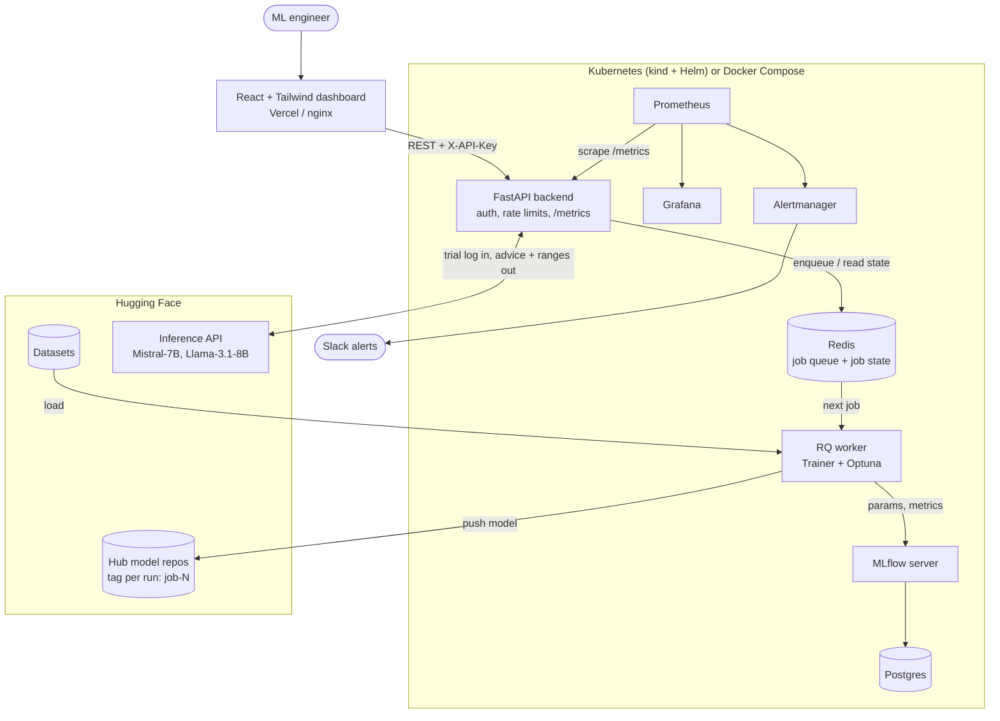
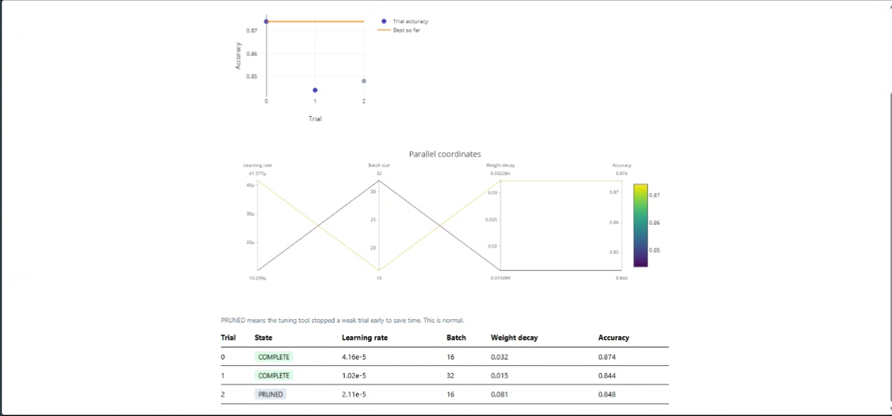

# HFAIO (7UP)

HFAIO automates the model lifecycle for Machine Learning Engineers: it fine-tunes Hugging Face Transformer models on any text-classification dataset, searches hyperparameters automatically with Optuna, asks LLMs (Mistral and Llama) to read the results and suggest better settings, stores every trained model as a versioned Hugging Face Hub release, tracks every experiment, and deploys and monitors everything through a Kubernetes pipeline.

**Problem:** text classification. The demo uses binary sentiment (positive vs. negative) on the SST-2 movie-review dataset, but any Hugging Face dataset ID or uploaded CSV with a text column and a label column works (binary or multi-class). Any Hugging Face sequence-classification model can be imported by its Hub ID, fine-tuned, tuned, and compared on the same evaluation set.

### Features
*   **Fine-tuning** of any Hub model, with linear warmup and decay, weight decay, and best-epoch selection with early stopping.
*   **Custom datasets:** any Hugging Face dataset ID (with column mapping and an Inspect button that lists its splits and columns) or a CSV upload.
*   **Hyperparameter search** with Optuna (median pruning) over a search space you set in the UI.
*   **LLM-powered insights:** `POST /insights/studies/{id}` reads the Optuna trial log and `POST /insights/jobs/{id}` reads a run's MLflow metrics. Both send the results to Mistral-7B-Instruct and Llama-3.1-8B-Instruct on the Hugging Face Inference API. The answers appear side by side with a suggested search space, and one click starts the next study with it. A rule-based check runs as a fallback.
*   **Hugging Face Hub model storage and versioning:** every finished run is pushed to the Hub as a commit tagged `job-<id>`, with a generated model card. Models survive Space restarts and can be re-imported from the Model Hub page.
*   **A/B testing** of two runs with a two-proportion z-test on a shared evaluation set.
*   **Background workers:** training, tuning and A/B jobs run on an RQ worker backed by Redis, not inside API requests.
*   **API protection:** optional API key on all write endpoints, per-IP rate limits, and a cap on concurrent jobs.
*   **MLOps:** MLflow tracking, Prometheus metrics, Grafana dashboard, Slack alerts, Docker, Helm on kind, GitHub Actions CI/CD with Trivy scanning and pytest.

**Model:** `distilbert-base-uncased`, a small, fast pretrained English model from Hugging Face, fine-tuned with a classification head sized to the dataset's labels (2 for SST-2).

## Team Members & Contributions
As per course requirements, all three members actively collaborate and commit to this repository.
*   **Jomiloju King (jomilojuking)** - Backend and ML core: FastAPI service, Hugging Face integration, Optuna tuning (on the Hugging Face Trainer, which uses Accelerate), MLflow logging, A/B testing
*   **Iyinoluwa Ayodele (grace502)** - Infrastructure and MLOps: Docker, Kubernetes and Helm, GitHub Actions CI/CD, Prometheus, Grafana, Slack alerts
*   **Pauline Ekoma (pekoma1)** - Frontend and experiment tracking: React and Tailwind dashboard, Plotly.js tuning charts, experiment tracker, monitoring views

---

## Architecture



On the Hugging Face Space (one container, no Redis) the same API falls back to in-process background tasks and in-memory state. Models still persist because they are pushed to the Hub. Monitoring and the runbook are in [docs/infra.md](docs/infra.md).

### Screenshots
| Tuning Studio | Grafana service dashboard | Slack alert |
| :---: | :---: | :---: |
|  |  |  |

---

## Live Demo
*   **Application URL:** [https://hfaio.vercel.app](https://hfaio.vercel.app/)
*   **Hosting:** the React frontend is on Vercel, and the FastAPI backend runs in a Docker Space on Hugging Face (free CPU).
*   **Note:** the hosted backend uses a shortened training setup (fewer sentences and fewer epochs) because the free server has only 2 CPU cores, so scores there are lower than the results below. Imported models, runs, and tuning studies live in the backend's memory and reset whenever the Space restarts, but trained models are pushed to the Hugging Face Hub (when the Space has an `HF_TOKEN` secret) and can be re-imported from the Model Hub page.

### Project Walkthrough


---

## Installation & Setup

### Prerequisites
*   Python 3.11
*   `pip` or `conda`
*   Git
*   Node.js 18+ (frontend)
*   Docker and Docker Compose (full stack only)

### Local Installation
```bash
# Clone the repository
git clone https://github.com/jomilojuking/7UP.git
cd 7UP

# Terminal 1: backend (http://127.0.0.1:8000, API docs at /docs)
cd backend
python -m venv venv
source venv/bin/activate  # On Windows use: venv\Scripts\activate
pip install -r requirements.txt
uvicorn app.main:app --reload

# Terminal 2: frontend (http://localhost:5173)
cd frontend
npm install
npm run dev
```

### Deployment

The app is deployed in two parts:

*   **Backend:** the FastAPI service runs in a Docker Space on Hugging Face ([jomilojuking/hfaio-backend](https://huggingface.co/spaces/jomilojuking/hfaio-backend)), on the free CPU tier (2 cores). The Space uses its own `Dockerfile`, which installs the CPU build of PyTorch and the packages from `requirements.txt` and serves the API on port 7860. Saved models and database files are not included in the Space.
*   **Frontend:** the React app is built with `VITE_API_URL` set to the Space's address and hosted on Vercel at [hfaio.vercel.app](https://hfaio.vercel.app/).

Because the free server is small, the Space uses a shortened training setup, set as environment variables in its `Dockerfile`: `MAX_TRAIN=500`, `MAX_EVAL=200`, and `TUNE_EPOCHS=1` (one epoch per tuning trial). Scores on the hosted site are therefore lower than the results below, which came from a local run. The Space's disk is not persistent, so imported models, runs, and tuning studies reset whenever it restarts. Add these Space secrets: `HF_TOKEN` (write access, for Hub storage and LLM insights) and `HFAIO_API_KEY` (protects training endpoints); build the Vercel frontend with the same value in `VITE_API_KEY`.

To run the frontend against a different backend, create `frontend/.env.local` containing `VITE_API_URL=<backend url>` and restart `npm run dev`. By default it calls `http://127.0.0.1:8000`. Delete that file to go back to the local backend.
### Full stack with Docker
Runs the backend, frontend, Postgres, Redis, MLflow, Prometheus and Grafana together:
```bash
cp .env.example .env    # then set the passwords and SLACK_WEBHOOK_URL
docker compose up --build
```

Copy `.env.example` to `.env` and fill in your own values. Never commit secrets. The stack includes a `worker` service that runs training jobs from the Redis queue; `docker compose up --scale worker=2` runs two at once if you have the memory.

### Configuration
| Variable | Purpose |
| :--- | :--- |
| `HF_TOKEN` | Write token. Enables pushing models to the Hub and the LLM insights. |
| `HF_REPO` | Optional fixed repo for pushed models (default: `<you>/hfaio-<model>-<dataset>`). |
| `INSIGHT_MODELS` | Comma-separated chat models for insights (default Mistral-7B-Instruct and Llama-3.1-8B-Instruct; accept the Llama license on its model page first). |
| `HFAIO_API_KEY` | When set, every POST needs the `X-API-Key` header. Build the frontend with `VITE_API_KEY` set to the same value. |
| `MAX_ACTIVE_JOBS`, `RATE_LIMIT_HEAVY`, `RATE_LIMIT_DEFAULT` | Abuse protection for the public deployment. |
| `USE_WORKER`, `REDIS_URL` | Run jobs on the RQ worker and keep job state in Redis. |
| `MAX_TRAIN`, `MAX_EVAL` | Training and evaluation subset sizes. |

### Tests
```bash
cd backend
pip install pytest httpx fakeredis
pytest -q
```
The suite swaps model training for a fast fake, so it needs no GPU or downloads. CI runs it on every pull request.
Kubernetes (kind + Helm), CI/CD, monitoring and the runbook: see [docs/infra.md](docs/infra.md).

---

## Dataset
*   **Source:** [SST-2 (Stanford Sentiment Treebank, binary)](https://huggingface.co/datasets/stanfordnlp/sst2), part of the GLUE benchmark
*   **Description:** movie-review sentences labeled positive (1) or negative (0). The project trains on a random subset of the training split and evaluates on a random sample of the validation split, because the official test labels are hidden. Subset sizes are set by the `MAX_TRAIN` and `MAX_EVAL` environment variables (defaults: 4,000 and 500).
*   **Data Pipeline:** nothing to download manually. The backend loads it at training time with `load_dataset("stanfordnlp/sst2")` from the Hugging Face `datasets` library, and it is cached locally after the first run.

To see the full split sizes:
```bash
python -c "from datasets import load_dataset; print(load_dataset('stanfordnlp/sst2'))"
```

### Using your own data
Every training and tuning request takes a `dataset` object. In the UI, pick **Hugging Face dataset** or **Upload CSV** above the run settings.

```jsonc
// any Hub dataset (POST /datasets/inspect lists its splits and columns first)
"dataset": {"hub_id": "imdb", "text_column": "text", "label_column": "label", "eval_split": "test"}

// a CSV uploaded with POST /datasets/upload (multipart, field "file")
"dataset": {"upload_id": 3, "text_column": "review", "label_column": "sentiment"}
```

Labels can be integers, strings or a `ClassLabel`; they are mapped to class indices automatically, and the model gets the right number of output classes. If there is no labelled evaluation split, 10% of the training split is held out. Uploads are limited to `MAX_UPLOAD_MB` (20 MB by default).

---

## Model Architecture & Training
*   **Algorithm:** Hugging Face `AutoModelForSequenceClassification` with a classification head sized to the dataset's labels, loaded from any Hub ID and fine-tuned with the Hugging Face `Trainer`.
*   **Frameworks Used:** Hugging Face Transformers, Datasets, Accelerate, PyTorch, Optuna, FastAPI, React, Tailwind, Plotly.js, MLflow
*   **Training Process (Experiments run):** AdamW, learning rate 2e-5 with linear warmup over the first 10% of steps then linear decay to zero, weight decay 0.01, batch size 16, up to 3 epochs, maximum sequence length 128, evaluated at the end of each epoch. The best epoch by test accuracy is kept, and training stops early once accuracy stops improving.
*   **Hyperparameter Tuning (Optuna):** maximizes accuracy. The default search space is learning rate 1e-5 to 1e-4 (log scale), batch size 16 or 32, and weight decay 0 to 0.1, and every range can be changed in the Tuning Studio. Each trial trains for 3 epochs, and a median pruner stops weak trials early (pruning starts after the first 2 trials). The demo study used 3 trials.
*   **Evaluation:** every saved model can be reloaded and scored on the same shared evaluation set, so different models are compared fairly. Fine-tuned models are saved under `backend/models` and pushed to the Hugging Face Hub when `HF_TOKEN` is set.

### System Overview
*   **Backend (`/backend`):** FastAPI endpoints for importing models, datasets, fine-tuning, tuning studies, A/B tests and LLM insights (full list at `/docs`). Long jobs run on an RQ worker (`app/tasks.py`). Experiments are logged to MLflow, Optuna studies are stored in `optuna.db`, and fine-tuned models are versioned on the Hugging Face Hub. A `/health` endpoint and Prometheus `/metrics` feed monitoring. Tests live in `backend/tests` and run in CI.
*   **Frontend (`/frontend`):** React and Tailwind dashboard with four pages (Model Hub, Tuning Studio, Experiments, Monitoring) and Plotly.js charts for tuning progress and experiments.
*   **Infrastructure (`/infra`, `/.github`):** Dockerfiles, Docker Compose, Helm chart deployed to kind with health checks and automated rollback, GitHub Actions CI/CD with Trivy security scanning, Prometheus, Grafana, and Alertmanager with Slack alerts. Details in [docs/infra.md](docs/infra.md).

---

## 📈 Evaluation & Results
**Baseline (v0.2):** performance of the fine-tuned `distilbert-base-uncased` on SST-2 binary sentiment classification (learning rate 2e-5, batch size 16, 1 epoch, constant learning rate, no weight decay). The training set is a random 2,000-sentence subset of the SST-2 training split. The test set is a random 500-sentence sample of the SST-2 validation split (the official test labels are hidden).

| Metric | Training Set | Test Set |
| :--- | :--- | :--- |
| Accuracy | 0.888 | 0.816 |
| Precision / F1-Score | 0.922 / 0.897 | 0.851 / 0.817 |
| Recall | 0.874 | 0.785 |
| Loss | 0.308 | 0.389 |

**Regularized training (v0.3):** linear warmup and decay, weight decay 0.01, up to 3 epochs with best-epoch selection, 4,000 training sentences, same 500-sentence test sample. Reproduce it with `cd backend && python scripts/benchmark.py`, which prints this table.

<!-- Paste the table printed by scripts/benchmark.py here. -->

The Experiments page also shows the train-test accuracy gap, and its **Explain** button asks the LLMs to diagnose over- or underfitting from a run's metrics.

All runs are logged to MLflow, and the Experiments page shows the same metrics for every run.


---
