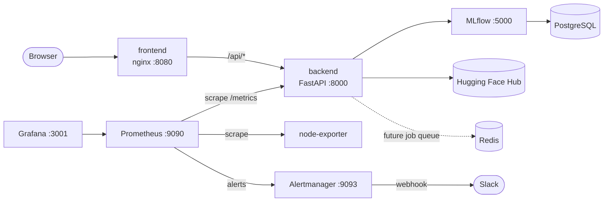
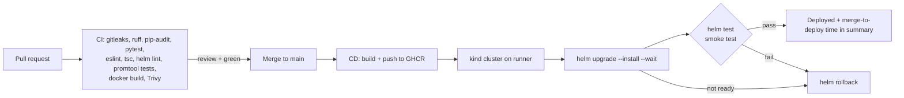

**Owner:** Iyinoluwa Ayodele 
**Project:** Hugging Face AI MLOps Orchestrator (HFAIO)  
**Course:** COSC 472


## Architecture








## Layout


| Path | What |
| --- | --- |
| `docker-compose.yml` | Whole local stack, one command |
| `.env.example` | Every variable, documented. Copy to `.env` |
| `backend/Dockerfile` | Multi-stage, CPU-only torch, non-root uid 10001, healthcheck (bridge task with JK) |
| `frontend/Dockerfile`, `frontend/nginx.conf.template` | Node build, unprivileged nginx, `/api` proxy (bridge task with Pauline) |
| `infra/mlflow/Dockerfile` | MLflow server + Postgres driver |
| `infra/postgres/init/` | Creates the `mlflow` database |
| `infra/prometheus/` | Scrape config, alert rules, rule unit tests |
| `infra/alertmanager/alertmanager.yml` | Slack receiver with runbook links |
| `infra/grafana/` | Datasource + dashboard provisioning, `dashboards/service-health.json` |
| `infra/helm/hfaio/` | Helm chart: Deployments, Services, ConfigMap, Secret, HPA, Ingress, PVC, smoke test |
| `infra/kind/kind-config.yaml` | Local single-node cluster |
| `infra/scripts/` | `kind-up.sh`, `deploy.sh` (auto-rollback), `protect-main.sh` |
| `.github/workflows/ci.yml`, `cd.yml` | CI on every PR, CD on merge to main |


## Run locally (Docker Compose)


```bash
cp .env.example .env          # set POSTGRES_PASSWORD, GRAFANA_ADMIN_PASSWORD, SLACK_WEBHOOK_URL
docker compose up --build -d
docker compose ps             # everything Up / healthy
```


| Service | URL |
| --- | --- |
| Frontend | http://localhost:3000 |
| Backend API docs | http://localhost:8000/docs |
| MLflow | http://localhost:5000 |
| Prometheus | http://localhost:9090 (Status → Targets, Alerts) |
| Alertmanager | http://localhost:9093 |
| Grafana | http://localhost:3001 → "HFAIO / Service health" |


All ports bind to `127.0.0.1`. The first backend build takes several minutes (torch). The image is about 2.8 GB.


## Deploy to Kubernetes (kind)


```bash
# needs docker, kind, kubectl, helm
infra/scripts/kind-up.sh                       # create cluster, build, load, deploy, smoke test
kubectl -n hfaio port-forward svc/hfaio-frontend 3000:80
```


`deploy.sh` runs `helm upgrade --install --wait` and then `helm test`. If either fails, it runs `helm rollback` to the last healthy revision.


**Rollback demo** (record this for the "broken deploy rolls back" proof):


```bash
SKIP_BUILD=1 infra/scripts/kind-up.sh                      # healthy revision 1
infra/scripts/deploy.sh -f infra/helm/hfaio/values-kind.yaml \
 --set backend.image.tag=does-not-exist --set TIMEOUT=2m    # never becomes ready
# -> [deploy] FAILED ... Rolling back hfaio to revision 1
helm history hfaio -n hfaio
```


Chart notes:
- The backend runs **1 replica**. Job and study state lives in process memory (`backend/app/state.py`), so extra replicas would not see each other's jobs. `backend.autoscaling` stays off until that state moves to Postgres. The frontend HPA (CPU 70%, 1–4 replicas) is on and needs metrics-server to act.
- Every pod runs as non-root with a read-only root filesystem, all capabilities dropped, seccomp `RuntimeDefault`, and no service-account token.
- Secrets come from `secrets.existingSecret`. CD creates it from GitHub Actions secrets, so values never pass through git.


## CI/CD


**CI** (`ci.yml`, every PR and push to main): gitleaks over full history · ruff (pinned version, `ruff.toml`) · pip-audit · pytest + coverage when `backend/tests` exists · eslint, `tsc` + Vite build, Vitest when present, `npm audit` · helm lint/template · `docker compose config` · promtool config check + alert unit tests · amtool · Docker build of both images + Trivy (HIGH/CRITICAL, fixed only, fails the build).


**CD** (`cd.yml`, merge to main): pushes `ghcr.io/<owner>/hfaio-{backend,frontend}:sha-<7>` and `:latest`. It then creates a kind cluster on the runner, side-loads the images, creates the `hfaio-secrets` Secret from `HF_TOKEN`/`HF_REPO` repo secrets, and runs `deploy.sh`. The job summary reports **merge-to-deploy time**.


All third-party actions are pinned to commit SHAs, and scanner images to digests.


**Branch protection:** a repo admin runs `infra/scripts/protect-main.sh jomilojuking/7UP` once. It requires PRs, 1 code-owner review, and passing CI, and it blocks force pushes.


## Monitoring


Metrics come from `prometheus-fastapi-instrumentator` on the backend's `/metrics`:
`http_requests_total{handler,method,status="2xx|4xx|5xx"}` and `http_request_duration_seconds_bucket`.


The Grafana dashboard **HFAIO / Service health** shows backend up, request rate, 5xx error rate, p50/p95/p99 latency, rate and latency per endpoint, host CPU and memory, and firing alerts.


| Alert | Condition | Severity |
| --- | --- | --- |
| BackendDown | `up{job="backend"} == 0` for 1m | critical |
| HighErrorRate | 5xx > 5% of requests over 2m, for 1m | critical |
| HighLatencyP95 | p95 > 1s over 5m, for 5m | warning |
| HostLowMemory | < 10% memory available for 5m | warning |


Rules are unit-tested in `infra/prometheus/tests/alerts.test.yml` (run in CI).


**Trigger a real Slack alert:** set `SLACK_WEBHOOK_URL` in `.env`, run `docker compose up -d alertmanager`, then `docker compose stop backend`. About 90 s later Slack shows `[FIRING] BackendDown` with a runbook button. `docker compose start backend` sends `[RESOLVED]`.


## Runbook


### Runbook: BackendDown
1. `docker compose ps backend` / `kubectl -n hfaio get pods`. Is it restarting?
2. Logs: `docker compose logs --tail 100 backend` / `kubectl -n hfaio logs deploy/hfaio-backend`.
3. If it was OOM-killed (`docker inspect hfaio-backend-1 --format '{{.State.OOMKilled}}'`, or `OOMKilled` in `kubectl describe pod`), a training run used too much memory. Lower `MAX_TRAIN`, or raise `mem_limit` / `backend.resources.limits.memory`.
4. If it broke right after a deploy: `helm rollback hfaio -n hfaio`.


### Runbook: HighErrorRate
1. Grafana → "Responses by status class" and "Requests per second by endpoint" show which handler fails.
2. Backend logs show the stack trace: `docker compose logs backend | grep -A20 Traceback`.
3. Common causes: Hugging Face Hub unreachable or rate-limited (check `HF_TOKEN`), MLflow down (`curl localhost:5000/health`), disk full under `/data`.
4. If it started with a new release, roll back: `helm rollback hfaio -n hfaio`.


### Runbook: HighLatencyP95
1. Check whether a fine-tune or Optuna study is running (`GET /finetune/jobs/{id}`). Training shares CPU with the API.
2. Grafana "p95 latency by endpoint" shows which handler is slow. `/models/import` depends on Hub latency.
3. Host CPU near 100% means you should wait for the job, lower `MAX_TRAIN`, or give the backend more CPU.


### Runbook: HostLowMemory
1. `docker stats --no-stream` shows which container is growing.
2. Stop the training job or lower `MAX_TRAIN` / `MAX_EVAL`.
3. On a small machine, stop non-essential services: `docker compose stop node-exporter grafana`.


### Troubleshooting: containers cannot reach each other (GitHub Codespaces)
Symptoms: frontend `/api/*` returns 504, Prometheus targets show `context deadline exceeded`, `wget backend:8000` times out inside containers.


Some Codespaces images keep a legacy-iptables `FORWARD` chain with policy `DROP`, and that chain blocks traffic on Compose bridge networks. The fix is not persistent, so re-run it after a Codespace restart:


```bash
sudo iptables-legacy -I FORWARD -i br-+ -j ACCEPT
sudo iptables-legacy -I FORWARD -o br-+ -m conntrack --ctstate RELATED,ESTABLISHED -j ACCEPT
```


## Security


- Secrets live only in `.env` (git-ignored), GitHub Actions secrets, and Kubernetes Secrets. gitleaks runs in CI on the full history.
- Containers run as non-root: backend uid 10001, frontend uid 101, MLflow uid 10002. The Kubernetes pods also use a read-only root filesystem and drop all capabilities.
- Only `127.0.0.1` ports are published in Compose. nginx sends `X-Content-Type-Options`, `X-Frame-Options` and `Referrer-Policy`, and hides its version.
- Dependency and image scanning: pip-audit, npm audit, and Trivy all fail CI on HIGH/CRITICAL issues that have fixes.


## Roadmap (planned, not built)


These items are in the plan but out of MVP scope. Do not list them as done on a resume.
- Canary / blue-green rollout and an error-rate-based rollback (today the rollback triggers on readiness and the smoke test)
- Model-promotion workflow with an evaluation gate on the `candidate` tag
- Separate model-serving Helm chart (one release per Hub model ID)
- NetworkPolicies (ingress → backend → database only), sealed-secrets, image digest pinning in the chart
- Prediction-confidence and drift (PSI) metrics, plus GPU metrics. These need backend instrumentation first.
- Deploying to a persistent cluster (a self-hosted runner, or a `KUBECONFIG` secret) instead of an ephemeral kind cluster


